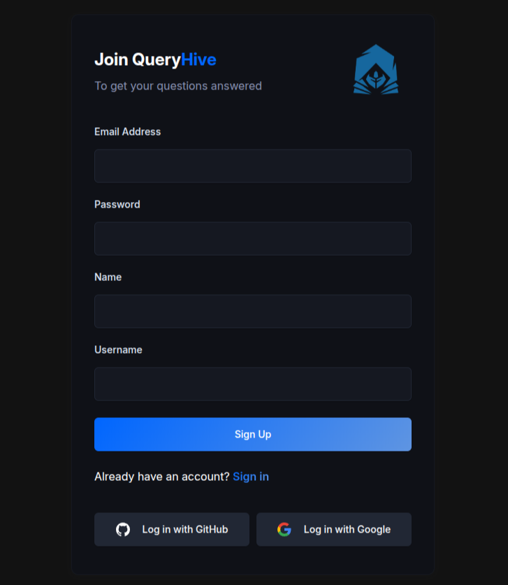
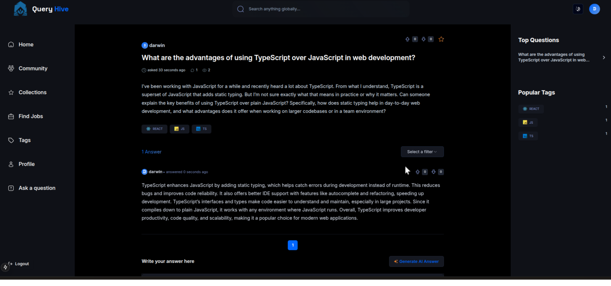
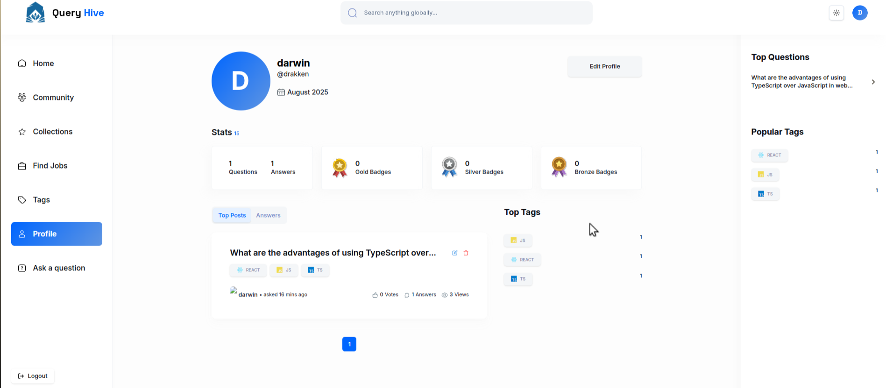
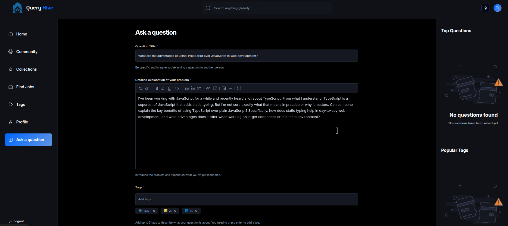
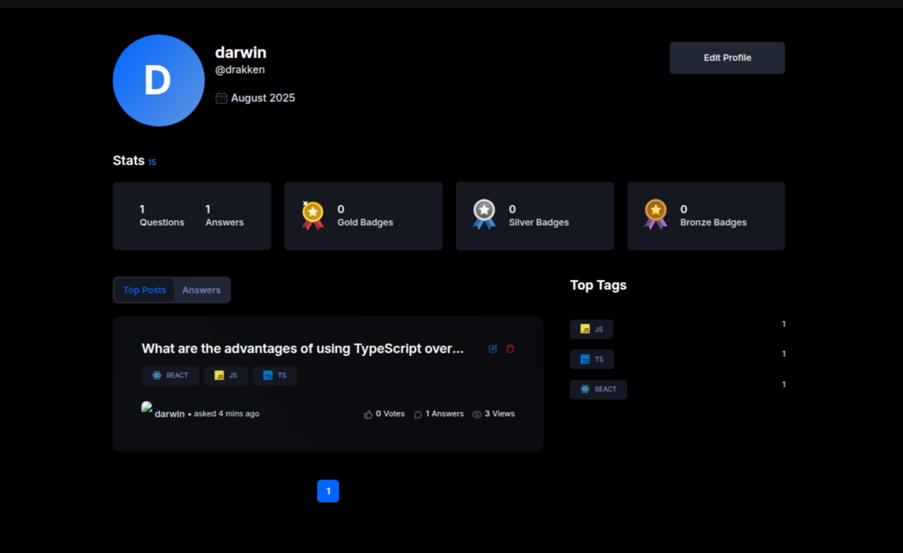
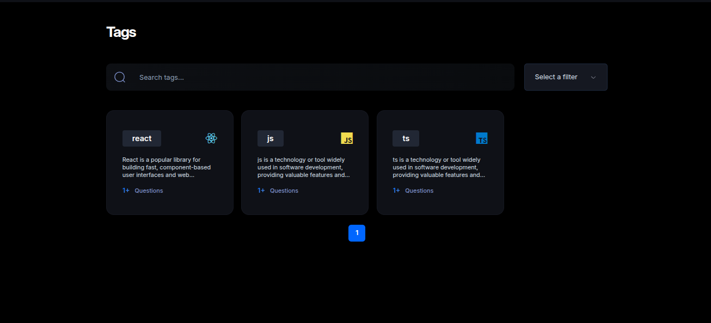

# QueryHive

## 📸 Screenshots

### Sign-Up



### Home Page



### Light-Mode



### Question Page



### Profile



### Tags



## Quick Start

Follow these steps to set up the project locally on your machine.

**Prerequisites**

Make sure you have the following installed on your machine:

- [Git](https://git-scm.com/)
- [Node.js](https://nodejs.org/en)
- [npm](https://www.npmjs.com/) (Node Package Manager)

**Cloning the Repository**

```bash
git clone https://github.com/drakkken/Query_hive_v2.git
cd Query_hive_v2
```

**Installation**

Install the project dependencies using npm:

```bash
npm install
```

**Set Up Environment Variables**

Create a new file named `.env` in the root of your project and add the following content:

```env
# Mongodb
MONGODB_URI=

# OpenAI
OPENAI_API_KEY=

# Rapid API
NEXT_PUBLIC_RAPID_API_KEY=

# Auth
AUTH_GOOGLE_ID=
AUTH_GOOGLE_SECRET=
AUTH_GITHUB_ID=
AUTH_GITHUB_SECRET=
AUTH_SECRET=
NEXTAUTH_URL=

# Tiny Editor
NEXT_PUBLIC_TINY_EDITOR_API_KEY=

NEXT_PUBLIC_SERVER_URL=

NODE_ENV=
```

Replace the placeholder values with your actual credentials. You can obtain these credentials by signing up on the respective websites.

**Running the Project**

```bash
npm run dev
```

Open [http://localhost:3000](http://localhost:3000) in your browser to view the project.
